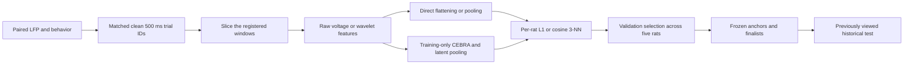

# Historical presentation reproduction

This companion covers the 48-page `Presentation 2 (Week 8) (1).pdf`. It is separate from the final poster’s fixed 500 ms comparison. The source PDF is not distributed here; it contains third-party illustrations. Page numbers below are physical PDF pages, including the title and appendix.

## Rebuild the figures

From the repository root:

```bash
uv sync --locked
uv run --locked jupyter lab
```

Open the notebooks using the root Python 3 kernel. Keep the source notebooks output-free in Git. Derived figures and preprocessing caches belong in ignored `results/`.

| PDF pages | Material | How to reproduce |
| --- | --- | --- |
| 1–7, 16–20, 22, 29–31, 36–38, 48 | Rubrics, motivation, study design, schematic CEBRA/decoder method, conclusions, and timeline | Design and decoder comparison below; render the supplied PDF for original artwork and layout. Page 38 lists a proposed GRU/transfer evaluation, not a completed result of this ablation. |
| 8–13, 15, 21 | LFP/behavior join, trial cohorts, split/purge, artifact example, normalization, Morlet features, sliding windows | [Preprocessing notebook](../notebooks/presentation_preprocessing.ipynb) and [ablation settings](configs/ablation.json). The Superchris T1 artifact panel uses trials 0 and 2; the normalization and Morlet examples use the recovered Mitt trial 0. The original normalization scaler is unknown. The measured window grid contains 100, 200, and 500 ms durations, not the illustrative 300 ms example. |
| 14, 39–42 | Raw PSD and 60 Hz spike; weak and plateau traces; time-local amplitude, channel coverage, relative SD, and line-peak heatmaps | [Preprocessing notebook](../notebooks/presentation_preprocessing.ipynb), from authorized raw NPZ recordings. The narrow 60 Hz LFP peak is consistent with electrical interference; it is not spike-unit firing. The paired before/after notch demonstration is new and separate from the slide’s raw PSD. |
| 23–26, 33 | Historical four-rat test anchors and finalists | [Decoding notebook](../notebooks/presentation_decoding.ipynb), from [archived score aggregates](evidence/model_scores.csv). No recordings, model fitting, or test reruns. |
| 27–28, 32, 34–35 | Five-rat validation windows, CEBRA architecture, update and seed comparisons, paired pooling | [Decoding notebook](../notebooks/presentation_decoding.ipynb). The paired pooling panel restricts both splits to the same four rats. |
| 43, 46 | Odor 3 delivery pulses and inter-odor dip/spike trace | [Preprocessing notebook](../notebooks/presentation_preprocessing.ipynb), recomputed from Mitt. The odor pulses are from the original source panel; the inter-odor figure uses a documented reconstruction because the original script is unavailable. |
| 44–45, 47 | Mitt odor- and channel-aligned LFP; correctness by recorded sample time | [Brain activity notebook](../notebooks/brain_activity_eda.ipynb), adapted from the original EDA. Keep separate incorrect-condition curves. Mitt has 22 LFP channels; odors A and D have correct OutSeq trials, but no incorrect OutSeq trials. |

The preprocessing notebook expects authorized `*_lfp.npz` and `*_bvr.npz` pairs under `data/raw_data/` for all five sessions. Its first run prepares a Mitt matched-window cache. Recomputed signal figures represent the documented analysis, not pixel copies of the deck. To reproduce the exact presentation layout with a local copy of the original PDF (SHA-256 in the [ablation settings](configs/ablation.json)), render all 48 pages with Poppler:

```bash
mkdir -p results/presentation-slides
pdftoppm -r 144 -png 'Presentation 2 (Week 8) (1).pdf' results/presentation-slides/slide
```

The archive aggregate regenerated byte-for-byte; all 80 validation heatmap cells match the PDF at displayed precision. The 245 archived historical test scores were cross-checked against saved predictions without refitting or applying any model to the test split.

## Historical ablation: independently implement the recipe

[Machine-readable ablation settings](configs/ablation.json) define cohort, guards, window grid, signal transforms, CEBRA training and pooling, decoder settings, and selection rules. This is an implementation specification, not a training runner. Request authorized recordings and historical weights from the data custodian if exact run replication is required.



| Stage | Window set | Compared components |
| --- | --- | --- |
| 1 | Onset-aligned 200 and 500 ms | Raw voltage, amplitude, phase, amplitude + phase, raw + CEBRA, wavelets + CEBRA; L1 and cosine 3-NN |
| 2 | Eight added windows within 0–500 ms | Four direct representations with L1 |
| 3 | Both anchors | Binned voltage; CEBRA mean vs 50 ms bins, 1,000 vs 5,000 updates, finalist seeds |
| 4 | Added windows and fixed finalist windows | Raw/wavelet CEBRA at added windows; offset5 vs offset10 at each finalist window |

The recovered run `run-d99f49d7dfac72c9` matches the plotted model scores at displayed precision. No receipt explicitly links the PDF export to a run. The aggregate file contains equal-session means, no trial-level records. Anyone with the authorized archive can regenerate it from the pinned validation and historical test **score tables**, without any training or test access:

```bash
PYTHONPATH=src uv run --locked python -B -m evaluation.presentation_scores \
  --archive /path/to/run-d99f49d7dfac72c9 --output results/presentation-model-scores.csv
cmp results/presentation-model-scores.csv presentation/evidence/model_scores.csv
```

## Later encoder–decoder matrix

This later 500 ms experiment is not the deck’s four-stage ablation. The [matrix protocol](configs/encoder_decoder_matrix.json) records eligible encoder/head combinations, feature construction, estimator defaults, Optuna budgets and seed rules, software versions, and promotion criteria. [Frozen settings](configs/encoder_decoder_selection.json) record the selected head knobs and actual encoder/head seed coverage by pair. The [matrix results](../poster/evidence/matrix.csv) and the [poster notebook](../notebooks/poster_results.ipynb) report outcomes; unscheduled combinations are not failures or zero scores.


| Item | Matrix design |
| --- | --- |
| Encoder inventory | 15: direct amplitude/voltage, covariance, GRF, PCA, MiniRocket, CEBRA, and continuous encoders |
| Decoder inventory | 13: linear, neighbor, discriminant, kernel, tree, boosting, and probabilistic heads |
| Registration | 195 possible entries per target; 66 scheduled and one historical anchor per target |
| Tuning | 32 fixed-head pairs and 100 finite-grid or TPE studies across both targets, excluding anchors |
| Selection | Mean of five within-rat five-class validation scores; use paired gains, session wins, leave-one-rat-out sensitivity, and available seed repeats for promotion |
| Reuse | The matrix reused authorized CEBRA and continuous checkpoints; the repo does not distribute those weights, full results, or the search runners |
