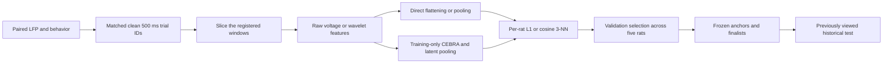

# Archived decoding experiments

Two experiments complement the poster’s fixed 500 ms comparison: a four-stage ablation of features and time windows, and a later encoder–decoder matrix.

## Rebuild the figures

From the repository root:

```bash
uv sync --locked
uv run --locked jupyter notebook
```

Open a notebook below, choose **Python 3 (ipykernel)**, and run all cells. Save generated figures and caches to `results/`, not Git.

| Analysis | Where to start | Inputs and scope |
| --- | --- | --- |
| Signal preparation and feature extraction | [Preprocessing notebook](../notebooks/presentation_preprocessing.ipynb) | Align voltage and behavior to odor onset, build trial windows, reject artifacts, fit normalization on training data, and compute Morlet wavelet features. The worked examples use Superchris T1 (trials 0 and 2) and Mitt trial 0. |
| Signal quality and 60 Hz interference | [Preprocessing notebook](../notebooks/presentation_preprocessing.ipynb) | Recompute spectra, weak/flat traces, and channel heatmaps. The 60 Hz line is consistent with electrical interference, not neuronal spike firing. The paired example shows the same training interval before and after notch filtering. |
| Odor pulses, inter-odor transitions, and behavior | [Preprocessing notebook](../notebooks/presentation_preprocessing.ipynb) · [Brain activity notebook](../notebooks/brain_activity_eda.ipynb) | Recompute the panels from Mitt. The inter-odor panel documents its event selection and is a reconstruction. Correctness is plotted by recorded time, excluding clock gaps. |
| Four-rat historical test and five-rat validation | [Decoding notebook](../notebooks/presentation_decoding.ipynb) · [Archived scores](evidence/model_scores.csv) | Render saved scores for direct and learned features, window lengths, pooling, and encoder settings. The paired pooling panel uses the same four rats on both splits. No recordings, fitting, or test reruns. |

For signal figures, put authorized `*_lfp.npz` and `*_bvr.npz` pairs for all five sessions under `data/raw_data/`. The first run prepares a Mitt matched-window cache. The notebook states the methods used for each figure, including any reconstructed examples.

## Historical ablation: independently implement the recipe

[Machine-readable ablation settings](configs/ablation.json) define cohort, guards, window grid, signal transforms, CEBRA training and pooling, decoder settings, and selection rules. This is an implementation specification, not a training runner. Request authorized recordings and historical weights from the data custodian if exact run replication is required.



| Stage | Window set | Compared components |
| --- | --- | --- |
| 1 | Onset-aligned 200 and 500 ms | Raw voltage, amplitude, phase, amplitude + phase, raw + CEBRA, wavelets + CEBRA; L1 and cosine 3-NN |
| 2 | Eight added windows within 0–500 ms | Four direct representations with L1 |
| 3 | Both anchors | Binned voltage; CEBRA mean vs 50 ms bins, 1,000 vs 5,000 updates, finalist seeds |
| 4 | Added windows and fixed finalist windows | Raw/wavelet CEBRA at added windows; offset5 vs offset10 at each finalist window |

The recovered run `run-d99f49d7dfac72c9` is the source of the checked-in aggregate. Its 245 historical test scores were checked against saved predictions without refitting or running a model on test data. The aggregate contains equal-session means, not trial-level records. Anyone with the authorized archive can regenerate it from the pinned validation and historical test **score tables**:

```bash
PYTHONPATH=src uv run --locked python -B -m evaluation.presentation_scores \
  --archive /path/to/run-d99f49d7dfac72c9 --output results/presentation-model-scores.csv
cmp results/presentation-model-scores.csv presentation/evidence/model_scores.csv
```

## Later encoder–decoder matrix

This later 500 ms experiment is separate from the four-stage ablation. The [matrix protocol](configs/encoder_decoder_matrix.json) records eligible encoder/head combinations, feature construction, estimator defaults, Optuna budgets and seed rules, software versions, and promotion criteria. [Frozen settings](configs/encoder_decoder_selection.json) record the selected head settings and actual encoder/head seed coverage by pair. The [matrix results](../poster/evidence/matrix.csv) and the [poster notebook](../notebooks/poster_results.ipynb) report outcomes; unscheduled combinations are not failures or zero scores.


| Item | Matrix design |
| --- | --- |
| Encoder inventory | 15: direct amplitude/voltage, covariance, GRF, PCA, MiniRocket, CEBRA, and continuous encoders |
| Decoder inventory | 13: linear, neighbor, discriminant, kernel, tree, boosting, and probabilistic heads |
| Registration | 195 possible entries per target; 66 scheduled and one historical anchor per target |
| Tuning | 32 fixed-head pairs and 100 finite-grid or TPE studies across both targets, excluding anchors |
| Selection | Mean of five within-rat five-class validation scores; use paired gains, session wins, leave-one-rat-out sensitivity, and available seed repeats for promotion |
| Reuse | The matrix reused authorized CEBRA and continuous checkpoints; the repo does not distribute those weights, full results, or the search runners |
